# GEO Content Distribution MVP Architecture

## 1. Purpose

The system continuously turns fresh public topics into evidence-bound
commercial soft-promotion articles and distributes account-specific variants
through tenant-owned platform accounts. It extends the existing GEO tenant,
variant, audit, grant, job, lease, and readback control plane rather than
creating a second workflow engine.

## 2. Component view

```mermaid
flowchart LR
    Sources["Six trend sources"] --> Intake["Trend intake"]
    Intake --> Cluster["Freshness and clustering"]
    Cluster --> Select["Campaign topic selector"]
    Select --> Evidence["Immutable fact snapshot"]
    Evidence --> Draft["AI drafting"]
    Draft --> Variants["Platform and account variants"]
    Variants --> Review["Machine review"]
    Review --> Queue["Durable target queue"]
    Queue --> Bridge["Account-scoped platform bridges"]
    Bridge --> Platforms["Toutiao / Sohu / Baijiahao / NetEase"]
    Platforms --> Readback["Approval and public readback"]
    Readback --> Analytics["Account analytics and heat"]
    Analytics --> Select
    Analytics --> Console["Operations console and SSE"]
    Queue --> Console
```

## 3. Responsibilities

| Module                 | Responsibility                                                 | Does not own                              |
| ---------------------- | -------------------------------------------------------------- | ----------------------------------------- |
| Trend intake           | bounded collection, source evidence, normalized observations   | campaign decisions                        |
| Trend intelligence     | fingerprinting, clustering, freshness and velocity             | brand facts                               |
| Topic selector         | campaign relevance, evergreen fill, daily allocation           | article prose                             |
| Evidence provider      | immutable fact snapshot and claim support                      | future RAG or long-term knowledge storage |
| Content production     | master draft and lineage provenance                            | publication authority                     |
| Variant engine         | platform and account-specific immutable payloads               | browser sessions                          |
| Machine review         | pass, rewrite, or block final variants                         | grants and external writes                |
| Automation scheduler   | fair claims, leases, checkpoints, quotas and compensation      | platform DOM behavior                     |
| Platform bridge        | account identity, fixed surface contract, submit and reconcile | topic or copy decisions                   |
| Readback and analytics | independent public confirmation and native metrics             | retroactive payload mutation              |

## 4. Communication

Control-plane commands use tenant-authenticated HTTP APIs. Durable state and
work claims remain in PostgreSQL. The existing outbox wakes producers and
workers. Browser bridges expose fixed, account-bound commands; they do not
expose arbitrary selectors, navigation, scripts, or clicks. The web app uses
SSE for status events and refreshes authoritative snapshots over HTTP.

The MVP consumes an immutable tenant-scoped fact snapshot. It does not call a
RAG service or knowledge base. A future evidence provider can sit behind the
same port and return validated evidence packs without changing the draft,
variant, or audit contracts.

## 5. State flow

The canonical state sequence is defined in `diagrams/workflow.mermaid`.
Publication submission is the point of no blind retry. An uncertain submit is
reconciled on the same account. Public readback is independent from the editor
session and compares a stable public-content identity.

## 6. Security and authority

- Every persisted resource and event is tenant-scoped.
- A customer user belongs to one tenant. An operations user must select a
  tenant before acting, and the platform records both identities.
- Raw platform credentials never cross the browser-runtime boundary.
- Account-final payload and media hashes bind review, grant, submit, and
  readback.
- Only a passed review can receive a one-time publication grant.
- A model may research, draft, and request review. It cannot grant or perform
  an external write.
- Unknown platform capability defaults to preview/manual until canary evidence
  promotes the fixed adapter.

## 7. Error handling

| Failure class                | Result                                                       |
| ---------------------------- | ------------------------------------------------------------ |
| trend source unavailable     | source backoff; other sources continue                       |
| fact snapshot unavailable    | block concrete unsupported claims and keep the batch pending |
| model timeout or 429         | bounded retry or cheaper reviewed model                      |
| review rewrite required      | create a new variant, maximum two cycles                     |
| review blocked               | terminal item; enqueue replacement topic                     |
| session expired              | stop account; leave other accounts running                   |
| pre-submit transient failure | bounded backoff retry                                        |
| post-submit uncertainty      | same-account reconciliation, no resubmit                     |
| platform rejection           | classify; create replacement variant when correctable        |
| public readback mismatch     | terminal evidence failure; never count success               |

## 8. Scale

The scheduler is horizontally scalable through atomic database claims and
leases. Cross-account targets execute in parallel; an account defaults to one
external write at a time. An isolated account profile is durable disk state,
not a permanently running browser: a Browser Host starts it on demand, returns
it to a bounded runtime pool, and closes it after an idle timeout. The capacity
test exercises 10,000 target lifecycles per day and approximately 50 logical
account slots distributed across hosts; an individual host defaults to eight
active browsers and rejects a configured cap above sixteen. Source collection,
drafting, image work, publishing, and readback have separate concurrency and
error budgets so a slow provider cannot occupy every worker.

## 9. Observability

Every lineage carries campaign, topic, evidence-pack, policy-version, model,
variant, account, review, grant, attempt, receipt, and readback identifiers.
The console exposes stage counts and latency, source freshness, rewrite and
block rates, account health, approval rate, readback success, quota use, and
cost. Provider messages and secrets are sanitized before logs or SSE events.

## 10. Reuse strategy

Use existing maintained libraries for HTTP, HTML/XML parsing, robots policy,
validation, browser control, and model providers. Mature platform projects are
source material for visible page flow and stable native controls. GEO retains
its own deep modules for tenant authority, immutable lineage, grants,
post-submit reconciliation, and public readback because no audited reference
project supplies those guarantees.
