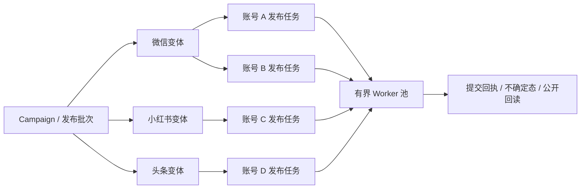

# AIWriteX 源码深度评估与 GEO 映射

日期：2026-08-03
研究对象：[iniwap/AIWriteX](https://github.com/iniwap/AIWriteX)，源码快照 `9688554b3bc1db82afe2080dda9a1b14716b16c5`
快照时间：2026-07-10，版本标记 V2.4.8
目标：判断 AIWriteX 对 GEO 的热点采集、AI 创作、平台变体、账号登录、多平台自动发布、并行任务、短视频和 UI 建设是否有可复用价值。

## 结论

**AIWriteX 值得学习产品流程和少量领域概念，但不适合作为 GEO 的代码或发布架构底座。**

它最有价值的部分是：

1. 多热点源带失败回退的选题入口。
2. “选题 -> 创作 -> 优化 -> 平台格式化 -> 发布”的可见阶段模型。
3. 创意维度、工作坊和平台 adapter 的产品组织方式。
4. 微信公众号草稿、发布 API 的真实接入路径，可用于 GEO 做能力调研。

它不能解决 GEO 当前最重要的生产问题：

- 多平台发布并未成熟落地。除微信公众号外，主要平台的 `publish` 都返回 `NOT_IMPLEMENTED`。
- 没有并行多任务异步发布。后端只有一个全局进程槽，占用时直接返回 HTTP 409。
- 微信多账号发布是同步 `for` 循环，失败隔离、租约、公平调度和独立回执都不足。
- 没有平台账号登录层，只有本地明文微信公众号 `appid/appsecret` 配置。
- “短视频”只是把文章截成约 60 秒的文本脚本，不包含视频生产与交付链路。
- 配置、文件和网络访问边界不适合多租户 SaaS。
- 根 `LICENSE` 与 `NOTICE` 的附加限制存在明显张力，商业 GEO 不应直接复制代码。

因此推荐 **clean-room 学习**：采用它的阶段语言、创作维度和工作坊体验；用 GEO 自己的研究证据、平台变体、账号隔离、durable job、租约、幂等、不确定态和回读体系重新实现。

## 总体评分

| 维度         | 完成度 | 对 GEO 的参考价值 | 判断                                                          |
| ------------ | -----: | ----------------: | ------------------------------------------------------------- |
| 热点采集     |   6/10 |                高 | 有多个来源和回退，但偏随机选题，缺治理、聚类、热度和证据链    |
| AI 文章创作  |   7/10 |                高 | 创作阶段、提示词和创意维度较丰富，缺事实约束和结构化产物      |
| 平台内容变体 |   5/10 |              中高 | 有 adapter 格式化接口，但没有不可变 variant、审计和策略版本   |
| 账号登录     |   1/10 |                低 | 没有 OAuth/扫码/浏览器会话生命周期，只配置微信密钥            |
| 自动发布     |   3/10 |                中 | 微信 API 可参考；其他主要平台是占位实现                       |
| 异步并发     |   1/10 |          负面教材 | 单全局任务、同步账号循环，所谓 parallel 实际映射为 sequential |
| 短视频       |   1/10 |                低 | 只有抖音文本脚本，没有媒体生产、渲染或上传                    |
| UI           |   6/10 |              中高 | 阶段流和创作工作坊可借鉴，进度存在计时模拟成分                |
| 测试         |   1/10 |                低 | 两个顶层脚本，无断言、mock、合同测试和 CI                     |
| 安全         |   2/10 |          负面教材 | 明文密钥、无 API 鉴权、任意文件路径和 SSRF 风险               |
| 许可         | 高风险 |    仅可做行为研究 | `NOTICE` 增加非商业、禁止再分发和禁止 SaaS 等限制             |

## 1. 真实架构与成熟度

AIWriteX 是一个本地优先的 Python 应用：FastAPI 提供本机 Web API 和静态界面，CrewAI/模型调用负责内容生成，平台 adapter 负责格式化与发布。它更接近“单用户创作工具”，不是多租户内容分发平台。

真实主链路是：

```text
热点源抓取
  -> 随机选择候选主题
  -> 统一文章生成工作流
  -> 创意维度增强
  -> 平台 adapter 格式化
  -> 微信 API 发布，或其他平台返回 NOT_IMPLEMENTED
```

README 宣称支持多个平台的自动发布和一键工作流，但源码显示发布能力没有达到同样范围。判断成熟度必须以 adapter 的 `publish` 实现为准，而不是以平台名称是否出现在 UI/README 为准。

源码证据：

- [README 的多平台和自动发布声明](https://github.com/iniwap/AIWriteX/blob/9688554b3bc1db82afe2080dda9a1b14716b16c5/README.md#L20-L30)
- [README 的使用流程](https://github.com/iniwap/AIWriteX/blob/9688554b3bc1db82afe2080dda9a1b14716b16c5/README.md#L109-L121)
- [平台 adapter 抽象接口](https://github.com/iniwap/AIWriteX/blob/9688554b3bc1db82afe2080dda9a1b14716b16c5/adapters/platform_adapters.py#L66-L115)
- [统一文章工作流](https://github.com/iniwap/AIWriteX/blob/9688554b3bc1db82afe2080dda9a1b14716b16c5/core/unified_workflow.py#L55-L113)

## 2. 热点自动抓取

### 已实现

`hotnews.py` 集成了多个热点来源，并通过顺序回退提高“至少拿到一个题目”的概率。不同源会归一成标题、URL、热度等基础字段，然后从候选中选择主题进入创作。

- [热点来源入口与数据归一](https://github.com/iniwap/AIWriteX/blob/9688554b3bc1db82afe2080dda9a1b14716b16c5/hotnews.py#L20-L39)
- [首组来源抓取](https://github.com/iniwap/AIWriteX/blob/9688554b3bc1db82afe2080dda9a1b14716b16c5/hotnews.py#L42-L70)
- [更多来源和容错](https://github.com/iniwap/AIWriteX/blob/9688554b3bc1db82afe2080dda9a1b14716b16c5/hotnews.py#L73-L113)
- [来源回退](https://github.com/iniwap/AIWriteX/blob/9688554b3bc1db82afe2080dda9a1b14716b16c5/hotnews.py#L116-L131)
- [候选处理](https://github.com/iniwap/AIWriteX/blob/9688554b3bc1db82afe2080dda9a1b14716b16c5/hotnews.py#L134-L165)
- [最终主题选择](https://github.com/iniwap/AIWriteX/blob/9688554b3bc1db82afe2080dda9a1b14716b16c5/hotnews.py#L168-L188)

这种“多来源 + 降级回退”值得保留，因为热点源经常限流、改版或短时不可用。

### 缺失与风险

- 回退解决的是可用性，不是热点质量。没有跨源聚类、趋势速度、时间衰减、重复合并和可信度评分。
- 主题选择带随机性，无法解释“为什么选中”，也不利于重放和审计。
- 没有保存来源响应摘要、解析器版本、抓取时间、原始榜位和内容指纹。
- 没有站点政策、robots、许可和引用范围的系统治理。
- 抓取、选题、生成耦合较紧，不能独立重跑某一阶段。

### GEO 应怎样实现

扩展现有 `packages/research/src/collector.ts`、`apps/api/src/research-contracts.ts` 和 `apps/api/src/research-service.ts`，不要新增一套绕开安全边界的热点爬虫。

建议引入以下领域对象：

| 对象                | 作用                                               |
| ------------------- | -------------------------------------------------- |
| `TrendSourcePolicy` | 来源、栏目、抓取频率、host、robots、许可和启停策略 |
| `TrendObservation`  | 某来源某一时刻的榜位、热度原值、抓取证据和内容指纹 |
| `TrendCluster`      | 同一事件的跨源聚类、速度、新鲜度、可信度和风险标记 |
| `TopicCandidate`    | 可进入创作的候选主题、选择理由和人工/策略决策      |
| `TrendSnapshot`     | 可重放的选题快照，避免后续榜单变化破坏审计         |

首期应优先官方 API、RSS 和公开榜单；HTML 解析器作为独立 adapter，默认关闭，经过来源条款确认后启用。

## 3. AI 文章创作

### 可借鉴的能力

统一工作流把研究、结构、写作和优化组织成可见步骤，提示词也覆盖标题、正文结构、SEO 和平台读者等因素。相比单次 prompt，这个阶段模型更适合产品化。

- [文章生成提示词和输入组织](https://github.com/iniwap/AIWriteX/blob/9688554b3bc1db82afe2080dda9a1b14716b16c5/core/unified_workflow.py#L55-L113)
- [工作流任务组织](https://github.com/iniwap/AIWriteX/blob/9688554b3bc1db82afe2080dda9a1b14716b16c5/core/unified_workflow.py#L115-L131)
- [生成执行与结果处理](https://github.com/iniwap/AIWriteX/blob/9688554b3bc1db82afe2080dda9a1b14716b16c5/core/unified_workflow.py#L133-L200)

创意维度引擎把叙事角度、受众、风格和表达策略显式化，适合转化为 GEO 的“创作策略预设”：

- [创意维度定义与组合](https://github.com/iniwap/AIWriteX/blob/9688554b3bc1db82afe2080dda9a1b14716b16c5/creative/dimensional_engine.py#L95-L201)
- [维度选择逻辑](https://github.com/iniwap/AIWriteX/blob/9688554b3bc1db82afe2080dda9a1b14716b16c5/creative/dimensional_engine.py#L203-L247)
- [提示词构建](https://github.com/iniwap/AIWriteX/blob/9688554b3bc1db82afe2080dda9a1b14716b16c5/creative/dimensional_engine.py#L268-L306)
- [创意结果组织](https://github.com/iniwap/AIWriteX/blob/9688554b3bc1db82afe2080dda9a1b14716b16c5/creative/dimensional_engine.py#L397-L433)

### 不应照搬

- 生成以大段文本和提示词为中心，没有结构化 claim、evidence、citation 和 policy finding。
- 随机创意组合不利于比较、复现和审计。
- 没有把“素材事实”“编辑判断”“模型生成内容”分开保存。
- 缺少事实核验、相似度、引用许可、敏感内容和品牌规则门禁。
- `PARALLEL` 模式实际上仍映射到 CrewAI `Process.sequential`，不能把配置名称当成并发能力。[源码](https://github.com/iniwap/AIWriteX/blob/9688554b3bc1db82afe2080dda9a1b14716b16c5/core/content_generation.py#L61-L78)

### GEO 映射

在 `packages/agent/src/automation-runtime.ts` 与 `apps/api/src/agent-run-gateway.ts` 内，把创意维度转化为版本化、可解释的 `EditorialStrategy`：

- 每次生成固定记录策略 ID、版本、受众、语气、结构、长度和模型参数。
- 输入只引用冻结的 research bundle 和允许使用的 claim facts。
- 输出先形成 canonical article，再进入平台 variant 层。
- 任何自动修改都形成新内容版本，不覆盖已批准版本。
- 质量门禁输出结构化 finding，而不是只给一个“优化完成”文本。

## 4. 平台内容变体

AIWriteX 的 adapter 接口体现了正确方向：先有统一内容，再由平台 adapter 格式化。但它仍主要是内存中的字符串转换，没有把变体建设成独立、冻结和可审计的业务实体。

### 当前实现

- adapter 基类定义格式化、验证和发布职责。[源码](https://github.com/iniwap/AIWriteX/blob/9688554b3bc1db82afe2080dda9a1b14716b16c5/adapters/platform_adapters.py#L66-L115)
- 微信 adapter 处理正文和多账号发布。[源码](https://github.com/iniwap/AIWriteX/blob/9688554b3bc1db82afe2080dda9a1b14716b16c5/adapters/platform_adapters.py#L152-L262)
- 小红书、抖音、头条、百家号、知乎、豆瓣分别有格式化逻辑，但发布方法没有完成。

### GEO 应采用的变体模型

继续扩展 `packages/core/src/platform-variant.ts`，保持以下不变量：

1. canonical content 永远不被平台格式化覆盖。
2. 每个 `platform + channel_account + content_version` 产生独立 variant。
3. variant 记录策略版本、文本、标题、标签、媒体引用、披露、payload hash 和创建时间。
4. 获得发布 grant 后冻结；修改必须生成新版本和新 grant。
5. 平台限制由版本化 `PlatformProfile` 驱动，不散落在 UI 和 connector 中。

建议首批平台 profile 覆盖：标题/正文/摘要长度、标签数量、链接策略、联系方式、封面比例、正文图片、声明、敏感词、定时发布能力、草稿能力和公开回读能力。

## 5. 账号登录与凭据

**AIWriteX 没有可供 GEO 采用的账号登录层。**

它的真实账号能力集中在微信公众号：用户在配置中填写 `appid` 和 `appsecret`，发布器用它们换取 access token。没有 OAuth 授权回调、扫码登录交接、浏览器 profile、平台身份归属校验、会话过期、挑战状态、重新认证或租户隔离。

- [微信 token 获取](https://github.com/iniwap/AIWriteX/blob/9688554b3bc1db82afe2080dda9a1b14716b16c5/tools/wx_publisher.py#L74-L106)
- [配置读取和敏感字段返回](https://github.com/iniwap/AIWriteX/blob/9688554b3bc1db82afe2080dda9a1b14716b16c5/web/api/config.py#L26-L55)
- [配置写入本地文件](https://github.com/iniwap/AIWriteX/blob/9688554b3bc1db82afe2080dda9a1b14716b16c5/web/api/config.py#L62-L103)

GEO 应扩展现有 `apps/web/src/channel-account-directory.tsx` 和 `apps/ctrip-bridge/src/account-browser-session-provider.ts` 的模型：

- `ChannelAccount` 保存租户拥有的平台身份、能力和状态，不保存可返回前端的原始 Cookie。
- `CredentialBinding` 只保存 secret store reference 或 opaque browser profile key。
- `SessionState` 至少有 `unbound/session_required/authenticated/ready/challenge_required/unavailable/disabled`。
- 登录必须是用户可见的 handoff；平台账号 ID/昵称需在绑定时回读确认。
- 同一账号的浏览器写操作串行化；不同账号可在全局容量内并行。
- 密钥读取、登录、发布和重新认证都写入审计事件。

微信公众号应优先使用官方 API；浏览器平台使用隔离 profile，不把 Cookie 传回普通 API 和 Web UI。

## 6. 自动发布的真实完成度

### 微信公众号

微信是唯一有真实提交路径的平台：

- [创建草稿](https://github.com/iniwap/AIWriteX/blob/9688554b3bc1db82afe2080dda9a1b14716b16c5/tools/wx_publisher.py#L108-L131)
- [提交发布](https://github.com/iniwap/AIWriteX/blob/9688554b3bc1db82afe2080dda9a1b14716b16c5/tools/wx_publisher.py#L269-L298)
- [adapter 的多账号同步循环](https://github.com/iniwap/AIWriteX/blob/9688554b3bc1db82afe2080dda9a1b14716b16c5/adapters/platform_adapters.py#L152-L262)

这段代码可以帮助 GEO 列出微信 connector 所需的 token、素材、草稿和发布能力，但不能原样采用。尤其需要重新验证微信当前 API 权限、发布状态查询、token 缓存、限流、幂等和错误码语义。

源码还有一个可靠性 bug：`is_verified` 被定义为方法，却在分支中按属性使用，使验证逻辑无法按预期工作。

- [方法定义与验证逻辑](https://github.com/iniwap/AIWriteX/blob/9688554b3bc1db82afe2080dda9a1b14716b16c5/tools/wx_publisher.py#L223-L230)
- [错误的属性式使用](https://github.com/iniwap/AIWriteX/blob/9688554b3bc1db82afe2080dda9a1b14716b16c5/tools/wx_publisher.py#L653-L672)

### 其他平台

以下平台虽然有 adapter 和内容格式化，却没有真实发布实现：

| 平台     | 发布源码事实                                                                                                                                  |
| -------- | --------------------------------------------------------------------------------------------------------------------------------------------- |
| 小红书   | [`NOT_IMPLEMENTED`](https://github.com/iniwap/AIWriteX/blob/9688554b3bc1db82afe2080dda9a1b14716b16c5/adapters/platform_adapters.py#L304-L311) |
| 抖音     | [`NOT_IMPLEMENTED`](https://github.com/iniwap/AIWriteX/blob/9688554b3bc1db82afe2080dda9a1b14716b16c5/adapters/platform_adapters.py#L357-L363) |
| 今日头条 | [`NOT_IMPLEMENTED`](https://github.com/iniwap/AIWriteX/blob/9688554b3bc1db82afe2080dda9a1b14716b16c5/adapters/platform_adapters.py#L415-L421) |
| 百家号   | [`NOT_IMPLEMENTED`](https://github.com/iniwap/AIWriteX/blob/9688554b3bc1db82afe2080dda9a1b14716b16c5/adapters/platform_adapters.py#L507-L513) |
| 知乎     | [`NOT_IMPLEMENTED`](https://github.com/iniwap/AIWriteX/blob/9688554b3bc1db82afe2080dda9a1b14716b16c5/adapters/platform_adapters.py#L575-L581) |
| 豆瓣     | [`NOT_IMPLEMENTED`](https://github.com/iniwap/AIWriteX/blob/9688554b3bc1db82afe2080dda9a1b14716b16c5/adapters/platform_adapters.py#L644-L650) |

因此 AIWriteX 不能作为“成熟多平台自动发布实现”使用。它最多提供平台 payload 设计的初稿。

## 7. 并行多任务异步发布

### AIWriteX 为什么不满足要求

后端用模块级 `_current_process` 保存当前生成进程。如果已有任务运行，新请求直接返回 409。进度和日志也围绕这个唯一进程组织。

- [单一全局进程状态](https://github.com/iniwap/AIWriteX/blob/9688554b3bc1db82afe2080dda9a1b14716b16c5/web/api/generate.py#L21-L24)
- [启动时的全局互斥](https://github.com/iniwap/AIWriteX/blob/9688554b3bc1db82afe2080dda9a1b14716b16c5/web/api/generate.py#L78-L141)
- [停止和状态查询仍指向单任务](https://github.com/iniwap/AIWriteX/blob/9688554b3bc1db82afe2080dda9a1b14716b16c5/web/api/generate.py#L151-L205)

同时：

- 微信多账号是同步循环，不是任务扇出。
- CrewAI 的 `PARALLEL` 配置仍执行 `Process.sequential`。
- 没有 durable queue、lease、heartbeat、attempt、retry schedule、dead letter、quota 或 reconciliation。
- 进程退出会丢失运行态；不能由另一 Worker 接管。
- 没有 batch/target 两级模型，UI 无法准确回答“20 个目标中哪 3 个失败、哪 1 个状态不确定”。

### GEO 的正确并发语义

GEO 已在 `apps/agent-mcp/src/automation-producer.ts`、`apps/api/src/postgres-automation-repository.ts`、`apps/worker/src/worker.ts` 和 `packages/connectors/src/types.ts` 拥有更合适的基础。应在此基础上形成两级模型：



并发规则应是：

1. 创建批次后立即返回 `batch_id`，API 不等待所有平台完成。
2. 每个目标生成独立 durable publication job，拥有自己的 lease、attempt、deadline 和状态。
3. 跨平台、跨账号在全局和平台容量内并行。
4. 同一账号的写操作默认串行，避免草稿覆盖、会话争抢和平台频控。
5. 每个平台设置独立并发、速率、日配额和 circuit breaker。
6. 只对明确 retry-safe 的提交前失败自动重试。
7. 点击或 API 提交后响应丢失，进入 `uncertain -> reconciling`，先回读再决定，禁止盲目重发。
8. 幂等键至少绑定 `tenant + content_version + variant + channel_account + schedule_slot`。
9. 单目标失败不取消整个批次；批次状态由目标状态聚合计算。
10. 用户可暂停批次、平台或账号，也可单独重试经过判定的失败目标。

建议目标状态：

```text
draft -> queued -> leased -> preparing -> submitting
      -> published -> verifying -> confirmed
      -> retry_wait -> queued
      -> uncertain -> reconciling -> confirmed | needs_review
      -> failed | cancelled
```

这才是“并行多任务异步发布文章”的产品与工程含义，而不是在一个 HTTP 请求中启动多个 `Promise`。

## 8. 短视频方向

AIWriteX 的抖音 adapter 只把文章段落截断、拼接成约 60 秒的文字脚本，然后发布方法返回未实现。[源码](https://github.com/iniwap/AIWriteX/blob/9688554b3bc1db82afe2080dda9a1b14716b16c5/adapters/platform_adapters.py#L315-L363)

这不能作为短视频能力底座。GEO 后续应引入独立的视频领域，而不是给文章表加几个字段：

| 对象               | 内容                                              |
| ------------------ | ------------------------------------------------- |
| `VideoProject`     | 主题、受众、时长、比例、平台族和 canonical script |
| `Scene`            | 分镜序号、旁白、屏幕文字、镜头意图、时长和转场    |
| `AssetRequirement` | 图片/视频/B-roll/音乐的来源、许可和生成要求       |
| `VoiceTrack`       | 声音、语言、语速、TTS 模型和音频 artifact         |
| `SubtitleTrack`    | 时间码、样式、安全区和可编辑字幕                  |
| `RenderManifest`   | 场景、素材、音轨、字体、尺寸、编码器和版本        |
| `VideoRendition`   | 9:16、1:1、16:9 等平台成片及 hash                 |
| `VideoVariant`     | 平台标题、描述、话题、封面、位置和发布策略        |

第一阶段可以生成“脚本 + 分镜 + 素材清单”，由人工完成渲染；第二阶段接入 TTS、字幕和模板渲染；第三阶段再接视频上传和公开回读。每一步都保留素材许可和生成审计。

## 9. UI 与过渡动画

### 可借鉴

AIWriteX 的 UI 把复杂创作拆成阶段，创意工作坊提供维度选择、状态反馈和日志流。这些体验比单一大表单更适合 GEO 的内容生产链。

- [阶段与进度管理模型](https://github.com/iniwap/AIWriteX/blob/9688554b3bc1db82afe2080dda9a1b14716b16c5/web/static/js/progress-manager.js#L1-L83)
- [创意工作坊编排](https://github.com/iniwap/AIWriteX/blob/9688554b3bc1db82afe2080dda9a1b14716b16c5/web/static/js/creative-workshop.js#L301-L468)
- [WebSocket 与日志队列](https://github.com/iniwap/AIWriteX/blob/9688554b3bc1db82afe2080dda9a1b14716b16c5/web/static/js/creative-workshop.js#L628-L709)

### 必须修正

进度管理器包含计时器驱动的模拟进度，不一定对应后端持久 checkpoint。[源码](https://github.com/iniwap/AIWriteX/blob/9688554b3bc1db82afe2080dda9a1b14716b16c5/web/static/js/progress-manager.js#L160-L215)

GEO 不能用假百分比掩盖真实状态。界面进度必须来自任务事件：抓取完成、证据冻结、初稿生成、审计通过、变体冻结、排队、提交、回读确认。

### 建议的信息架构

1. **热点雷达**：多源趋势流、聚类、新鲜度、速度、来源可信度、风险和选题篮。
2. **AI 创作室**：证据、提纲、canonical article、审计结果和版本历史。
3. **平台预览**：同屏切换各平台 variant，显示字符/图片/标签限制及差异。
4. **分发中心**：批次、目标矩阵、排期、队列、账号容量、失败和不确定态。
5. **账号与渠道**：登录交接、会话健康、平台能力、配额、重新认证和 Kill Switch。
6. **短视频工作台**：脚本、分镜、素材、配音、字幕、渲染和平台成片。

### 动效规范

用户要求“每个组件有过渡动画”，应解释为每种状态变化都有一致反馈，而不是所有组件持续运动：

- 页面进入与视图切换：160-220ms 淡入和 4-8px 位移。
- 列表新增、排序和队列移动：layout animation，但保持行高稳定。
- 平台预览切换：120-180ms crossfade，文本不重排闪烁。
- 抽屉、对话框和侧栏：统一 easing 和遮罩过渡。
- 按钮、筛选、tab 和账号状态：120-160ms 颜色/边框/图标过渡。
- 任务进度：只在真实 checkpoint 变化时动画，不循环伪造进度。
- 危险操作、审计表格和数字指标保持安静，避免动画干扰判断。
- 全面支持 `prefers-reduced-motion`，关闭非必要位移和自动动画。

建议在 `apps/web/src/styles.css` 定义 motion token，在 `apps/web/src/app.tsx`、`apps/web/src/operations.tsx` 和 `apps/web/src/automation-operations.tsx` 复用，避免每个组件各写一套时长和 easing。

## 10. 测试与可维护性

仓库的两个测试文件实际上是顶层执行脚本，没有断言、fixture、mock 或稳定隔离：

- [热点测试脚本](https://github.com/iniwap/AIWriteX/blob/9688554b3bc1db82afe2080dda9a1b14716b16c5/tests/test_hotnews.py#L1-L16)
- [搜索测试脚本](https://github.com/iniwap/AIWriteX/blob/9688554b3bc1db82afe2080dda9a1b14716b16c5/tests/test_aipy_search.py#L1-L17)

仓库也没有可见的 CI 工作流。`pyproject.toml` 的命令入口与实际模块布局存在一致性疑问。由此不能证明热点抓取、AI 工作流、微信发布或 UI 在干净环境可重复运行。

GEO 新增能力至少应覆盖：

- 热点 adapter 的正常响应、限流、超时、结构漂移、重复内容和 robots/host 策略。
- 选题聚类、时间衰减、来源权重和可重放结果。
- canonical article 与平台 variant 的冻结、hash、审计和 grant 失效。
- 账号租户隔离、凭据不可见、会话过期、扫码挑战和重新认证。
- 批次扇出、容量限制、同账号串行、跨账号并行、lease 接管和公平调度。
- 提交前失败、提交后响应丢失、不确定态、回读成功/不匹配和幂等重试。
- UI 的批次聚合状态、局部失败、取消、重试和 reduced motion。

## 11. 安全审计

以下问题使 AIWriteX 不适合直接部署为 SaaS：

1. 配置 API 会返回模型 API Key、微信 `appid/appsecret` 等配置，并可把它们写入本地配置文件。[读取](https://github.com/iniwap/AIWriteX/blob/9688554b3bc1db82afe2080dda9a1b14716b16c5/web/api/config.py#L26-L55)、[写入](https://github.com/iniwap/AIWriteX/blob/9688554b3bc1db82afe2080dda9a1b14716b16c5/web/api/config.py#L62-L103)
2. FastAPI 主链没有认证和租户授权中间件，主要依靠仅绑定本机降低暴露面；这不是多用户安全模型。
3. 文章 API 接受调用者提供的文件路径进行读取、写入和删除，存在越权文件访问风险。[源码](https://github.com/iniwap/AIWriteX/blob/9688554b3bc1db82afe2080dda9a1b14716b16c5/web/api/articles.py#L69-L110)
4. URL 验证只检查 `http/https` 和 `netloc`，允许访问 loopback、内网、云元数据地址或经 DNS/重定向进入私网，构成 SSRF 风险。[验证](https://github.com/iniwap/AIWriteX/blob/9688554b3bc1db82afe2080dda9a1b14716b16c5/utils/utils.py#L318-L323)、[请求路径](https://github.com/iniwap/AIWriteX/blob/9688554b3bc1db82afe2080dda9a1b14716b16c5/tools/search_template.py#L495-L504)
5. 多个外部请求没有明确 timeout，任务可能长期挂起并占用唯一全局任务槽。
6. 微信验证方法误用会削弱提交前能力检查。
7. 日志、配置和运行态没有按租户和敏感级别隔离。

GEO 应继续保留显式 host allowlist、DNS 公网地址验证、重定向逐跳验证、最大响应、超时、tenant scope、secret reference、审计 hash、一次性 submit permit、Kill Switch 和公开回读边界。

## 12. 许可判断

这是本项目最需要先挡住的风险。

仓库根 `LICENSE` 是 Apache License 2.0 全文，但 `NOTICE` 额外声明了非商业使用、禁止未经许可再分发和禁止作为 SaaS 等限制：

- [Apache-2.0 条款](https://github.com/iniwap/AIWriteX/blob/9688554b3bc1db82afe2080dda9a1b14716b16c5/LICENSE#L89-L128)
- [`NOTICE` 的附加限制](https://github.com/iniwap/AIWriteX/blob/9688554b3bc1db82afe2080dda9a1b14716b16c5/NOTICE#L6-L26)
- [README 的许可证警示](https://github.com/iniwap/AIWriteX/blob/9688554b3bc1db82afe2080dda9a1b14716b16c5/README.md#L317-L352)

这些附加限制与 Apache-2.0 的通常授权范围存在明显张力。工程团队不应自行选择对自己有利的解释。对商业 GEO 的务实结论是：

- 不复制源码、提示词、页面资产或大段配置。
- 只记录公开可观察的产品行为、接口形状和风险。
- 如确需复用代码，先取得作者书面商业授权并经法律审查。
- 热点正文、图片和第三方平台素材另有版权与平台条款，代码许可不授予内容再发布权。

## 13. Adopt / Adapt / Avoid

### Adopt：直接采用概念

- 创作阶段语言：选题、研究、生成、优化、格式化、分发。
- 创意工作坊的组合式界面。
- platform adapter 的统一职责边界。
- 多热点源失败回退的产品预期。
- 可见日志流和阶段状态反馈。

### Adapt：重做后采用

- 将热点回退改为受治理的 provider catalog、证据快照和质量评分。
- 将创意维度改为版本化 `EditorialStrategy`，去除不可解释随机性。
- 将平台格式化改为不可变、可审计的 `PublicationVariant`。
- 将阶段进度改为持久 checkpoint/event，不使用计时模拟。
- 将微信接入按当前官方 API、权限和回读语义重新实现。
- 将多账号循环改为批次扇出和独立 durable job。

### Avoid：明确禁止

- 在商业 GEO 中复制 AIWriteX 源码。
- 单一全局进程状态。
- 用同步 `for` 循环承担多账号发布。
- 把 `PARALLEL` 名称当作真实并行。
- 明文保存或通过配置 API 返回平台密钥。
- 接受任意文件路径和仅做 scheme/netloc 的 URL 校验。
- 用假百分比表现任务进度。
- 把按钮点击或 API 接受直接视为已公开发布。
- 对提交后不确定结果自动重发。
- 把短视频简化为文章摘要文本。

## 14. GEO 落地优先级

### P0：先建立可信底座

1. 设立许可 gate，AIWriteX 仅作为 clean-room 行为研究材料。
2. 在研究域增加 `TrendSourcePolicy/Observation/Cluster/Snapshot/TopicCandidate`。
3. 定义 `Campaign -> PublicationTarget -> PublicationJob -> Receipt` 两级任务与事件模型。
4. 明确并发策略：全局、平台、账号三级容量；同账号串行；跨账号并行。
5. 建立 account/credential/session 边界，前端和业务 API 不接触原始 Cookie/secret。
6. 固化提交不确定态、reconciliation、幂等键和公开回读规则。

### P1：完成文章闭环与新版 UI

1. 上线“热点雷达 -> AI 创作室 -> 平台预览 -> 分发中心”主流程。
2. 把创意维度改造成可保存、可复用和可比较的编辑策略。
3. 用 SSE/WebSocket 展示持久任务事件、局部失败和真实 checkpoint。
4. 使用现有 Worker/lease/retry 能力完成批次异步扇出。
5. 先接微信公众号官方 API，再按平台能力评审接浏览器辅助 connector。
6. 建立统一 motion token、状态过渡和 `prefers-reduced-motion`。

### P2：视频与更多平台

1. 建立 `VideoProject/Scene/RenderManifest/VideoRendition/VideoVariant`。
2. 逐步接入素材生成、TTS、字幕、模板渲染和人工审核。
3. 为小红书、头条、知乎、百家号等建立独立 capability matrix 与 connector。
4. 加入发布后效果回收、平台表现比较和策略实验，但不让指标直接绕过治理门禁。

## 15. 第一阶段验收标准

用户提出的第一阶段目标可以用以下可验证结果收口：

- 至少 3 个受治理热点源，能保留原始榜位、抓取时间、证据 hash，并完成跨源去重聚类。
- 用户可从热点聚类创建 canonical article，查看证据、提纲、版本和审计结果。
- 至少 2 个平台生成明显不同且通过各自限制检查的 variant。
- 至少 1 个平台完成真实发布与回读，另 1 个平台可完成受监督草稿写入。
- 一个批次可扇出到多个账号；跨账号实际并行，同账号不会并发写入。
- API 创建批次后立即返回；刷新或重启后任务状态不丢失。
- 单目标失败不影响其他目标；提交后断网不会自动重复发布。
- 分发中心展示每个目标的排队、执行、重试、不确定、回读和最终回执。
- 页面、列表、预览、抽屉和状态变化有统一过渡；开启 reduced motion 后无非必要位移。
- 所有 secret 对 Web UI、普通 API 响应和日志不可见。

## 最终判断

AIWriteX 对 GEO 的价值不是“拿来就能多平台发文”，而是提供了一个比较完整的创作产品想象：热点进入、分阶段写作、创意维度、平台格式化和可见进度。它暴露出的缺口也很有价值，尤其说明了为什么成熟 GEO 必须把账号身份、平台变体、任务队列、提交不确定态和公开回读建设成一等领域对象。

GEO 当前在研究安全、平台 variant、Worker、lease、重试、账号运行时和治理方面已经比 AIWriteX 更接近生产底座。接下来应吸收其工作坊体验，保留 GEO 的工程边界，优先交付“热点雷达 + AI 文章 + 多平台变体 + 批次异步分发”的完整闭环，再沿同一治理模型扩展到短视频。
